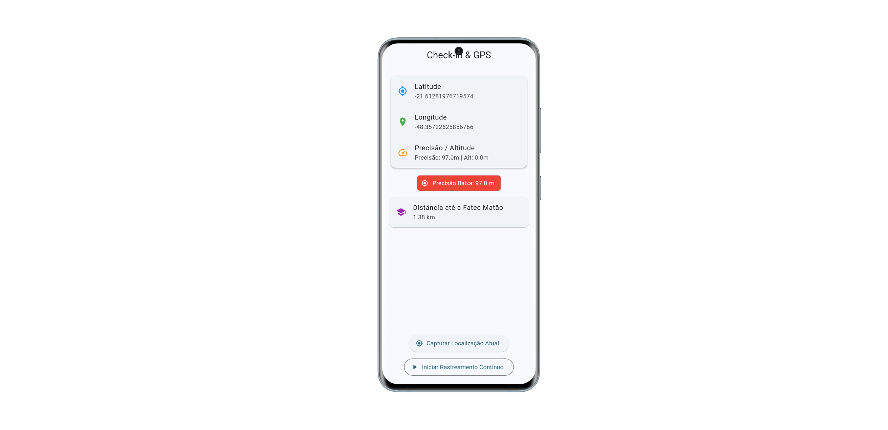
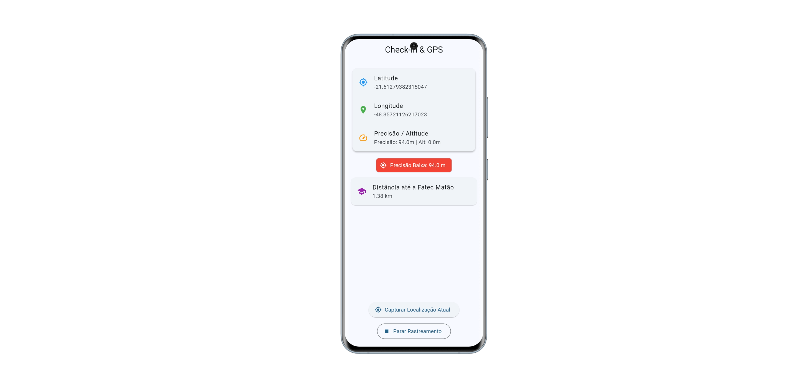

# Aula 14 - Geolocalizacao e GPS

Projeto Flutter utilizando o pacote `geolocator` para captura de coordenadas e rastreamento contínuo.

## Funcionalidades
- Verificação do serviço de GPS
- Tratamento de permissões e erros
- Captura única de coordenadas (`getCurrentPosition`)
- Rastreamento contínuo (`getPositionStream`)

## Desafios Implementados
- **Básico:** Chip de precisão (Verde < 15m, Amarelo 15-50m, Vermelho > 50m).
- **Intermediário:** Cálculo de distância até a Fatec Matão usando `distanceBetween`.

## Capturas de Tela

**1. Coordenadas capturadas:**


**2. Rastreamento contínuo:**


**3. Tratamento de erro (permissão negada):**


## Como rodar
```bash
flutter pub get
flutter run